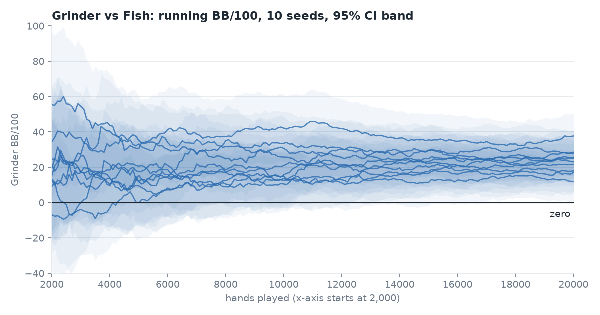
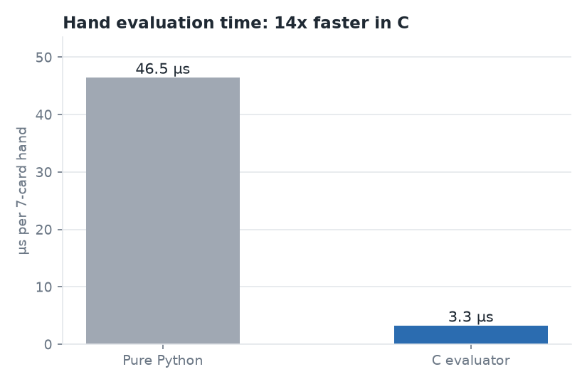

# PokerEngine

A heads-up No-Limit Hold'em simulation engine in Python, with a C hand evaluator and four agents that each decide differently: `Fish`, `Grinder`, `QuantGrid` and `Whale`. It plays seeded sessions and reports each agent's win rate in big blinds per 100 hands (BB/100) with a 95% confidence interval. Design notes and the build history are in `PokerEngine_Blueprint.md`.

## Results

- Grinder beats Fish by **23.7 BB/100** across 10 seeded 20,000-hand runs (95% CI excludes zero in 10/10; at 5,000 hands, only 3/10).
- The C hand evaluator is **14x faster** than pure Python (3.3 µs vs 46.5 µs per 7-card hand, median of 5 runs).
- About **10x faster** end to end on Monte Carlo equity.



*Grinder's running BB/100 for each of the 10 seeds, with 95% CI bands. The x-axis starts at 2,000 hands.*



*Median of 5 fresh-process runs of `scripts.bench_raw_evaluator`.*

## Agents

All four are position-blind and decide using a random roll against fixed thresholds.

- **Fish** is loose-passive: it uses a simple custom hand score, rarely folds (25% of weak hands facing a bet) and mostly calls. Facing a bet it raises 25% of the time with a score of 20 or more; with no bet it raises 20% of the time above a score of 35.
- **Grinder** is tight-aggressive and scores hands with the Chen formula (a standard preflop hand-strength score). Facing a bet it folds below 7, raises 30% of the time at 7 to 9 and 80% at 10 or more, and calls otherwise; with no bet it checks below 7 and raises 60% of the time at 10 or more.
- **QuantGrid** estimates win odds by Monte Carlo simulation and converts them to a Kelly fraction, with conservative sizing (Kelly alpha 0.25). Facing a bet it folds when the Kelly fraction is below 0.05, raises 30% of the time up to 0.35 and 80% above it; with no bet it raises 60% of the time when win odds are at least 50%.
- **Whale** uses the same win odds and raise/call splits as QuantGrid (Kelly fold floor 0.03 instead of 0.05) but sizes much bigger: Kelly alpha 1.0, 1.2x aggression, a randomized 0.8-1.6x size band on bets, and 1.5x-pot overbets when it raises with no bet.

## Quick start

```
python3 -m venv venv && ./venv/bin/pip install -r requirements.txt
make -C src/c_core        # builds the C evaluator with clang
./venv/bin/python -m pytest tests -q
```

`torch` is required; the Monte Carlo simulation imports it. Expected: `187 passed` with the C evaluator built (about 6 s). Without `make`, everything still works with a slower pure-Python evaluator, and the result is `172 passed, 15 skipped`.

## Reproducing the results

All timings were measured on an Apple M4 and will vary by machine.

### Why 20,000 hands

At 5,000 hands per seed (`python -m scripts.bb100_sweep --hands 5000`), the 95% interval excluded zero in only 3 of 10 seeds (mean 18.6 BB/100, one seed at 0.06), so the edge couldn't be told apart from noise at that sample size. At 20,000 hands it excludes zero in all 10.

<details>
<summary>Grinder vs Fish, 20,000 hands, 10 seeds (<code>./venv/bin/python -m scripts.bb100_sweep</code>)</summary>

```
seed  grinder_bb100  +/-ci95   lower   upper  excludes0  secs
1             23.07    12.26   10.82   35.33  True       1.17
2             12.02    11.74    0.28   23.75  True       1.19
3             24.92    12.55   12.37   37.47  True       1.18
42            27.81    12.56   15.26   40.37  True       1.19
99            25.67    12.32   13.35   37.99  True       1.18
123           17.16    11.75    5.41   28.91  True       1.18
555           37.74    12.67   25.07   50.41  True       1.19
777           28.55    12.71   15.84   41.26  True       1.20
1000          21.63    11.88    9.76   33.51  True       1.21
2026          17.99    11.93    6.06   29.92  True       1.19
CI excludes zero in 10/10 seeds
mean of 10 seed means: 23.66 BB/100 (min 12.02, max 37.74)
```

Each run takes about 1.2 s. Output is deterministic per seed apart from the timing column. Seed 2's lower bound is only 0.28, so the margin is thin there.

</details>

<details>
<summary>Grinder vs Fish, 5,000 hands, 10 seeds (<code>./venv/bin/python -m scripts.bb100_sweep --hands 5000</code>)</summary>

```
seed  grinder_bb100  +/-ci95   lower   upper  excludes0  secs
1             17.51    23.28   -5.77   40.79  False      0.30
2             11.96    24.90  -12.94   36.86  False      0.30
3             30.61    22.06    8.55   52.67  True       0.30
42            15.42    25.46  -10.04   40.88  False      0.30
99            20.63    20.95   -0.32   41.58  False      0.30
123            9.46    22.56  -13.10   32.02  False      0.29
555           35.23    25.15   10.08   60.38  True       0.30
777           33.22    24.58    8.64   57.80  True       0.30
1000           0.06    20.77  -20.71   20.83  False      0.30
2026          11.82    24.52  -12.70   36.34  False      0.30
CI excludes zero in 3/10 seeds
mean of 10 seed means: 18.59 BB/100 (min 0.06, max 35.23)
```

</details>

<details>
<summary>End-to-end speedup (<code>./venv/bin/python -m scripts.bench_c_eval</code>)</summary>

Times `calculate_win_odds()` (1,000 Monte Carlo simulations) with the C evaluator against the pure-Python one. Five runs, each in a fresh process: 10.2x, 10.6x, 10.6x, 10.4x, 10.3x (median 10.4x, about 95 ms down to 9 ms per call).

</details>

<details>
<summary>Evaluator alone (<code>./venv/bin/python -m scripts.bench_raw_evaluator</code>)</summary>

Over 2,000 random 7-card hands, five fresh-process runs (the ones behind the chart, from `scripts.make_plots`):

```
run: python 50.5 us, C 3.2 us, speedup 15.8x
run: python 50.6 us, C 3.2 us, speedup 15.8x
run: python 46.0 us, C 3.3 us, speedup 13.9x
run: python 46.5 us, C 3.3 us, speedup 14.1x
run: python 46.4 us, C 3.3 us, speedup 14.1x
median: python 46.5 us, C 3.3 us, speedup 14.1x
```

An earlier set of five runs gave 14.2x, 14.0x, 14.1x, 13.8x and 13.7x (45.5–46.3 µs in Python, 3.2–3.4 µs in C). Python timings drift by about 10% between runs, so the speedup ranges from about 13.7x to 15.8x and the median is about 14x.

</details>

To regenerate the charts: `./venv/bin/python -m scripts.make_plots` (writes `docs/img/`, about 15 s).

Tested with: Python 3.13.7 on an Apple M4 (macOS 26.5); numpy 2.5.4, pandas 3.0.6, scikit-learn 1.9.1, joblib 1.6.0, torch 2.14.1, matplotlib 3.11.2, seaborn 0.13.2, pytest 9.1.1. `requirements.txt` sets these as lower bounds.
